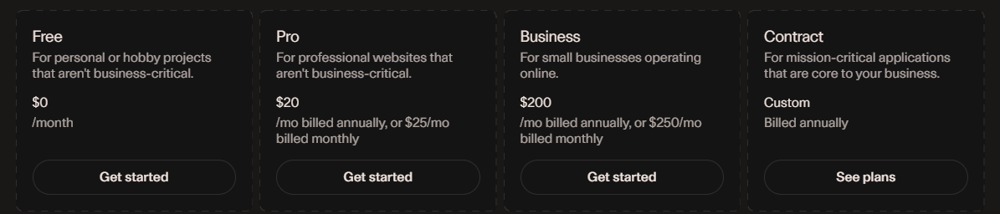

# Exposing Kubernetes Services with Cloudflare Tunnel

## Overview

[Cloudflare Tunnel](https://developers.cloudflare.com/cloudflare-one/connections/connect-networks/) exposes services running in the cluster to the internet without opening inbound ports or publishing the home network's public IP address. A `cloudflared` connector runs inside the cluster, opens outbound connections to Cloudflare's edge, and Cloudflare forwards incoming requests through them.

## Why Cloudflare Tunnel

Publishing services directly from a home network usually means forwarding ports on the router to an exposed IP address. Cloudflare Tunnel removes that need and brings several advantages:

* **Smaller attack surface**: the connector only makes outbound connections, so no inbound port is opened on the router or firewall. Nothing on the home network is reachable directly from the internet.
* **Hidden origin IP address**: clients only ever see Cloudflare's IP addresses. The home network's public IP isn't published in DNS, which protects it from targeted scans and attacks.
* **DDoS mitigation and WAF**: all traffic passes through Cloudflare's network, which absorbs volumetric attacks and filters malicious requests before they reach the cluster.
* **Works with any ISP setup**: since connections are outbound, the tunnel works behind CGNAT, with a dynamic public IP or with an ISP router that limits port forwarding. No dynamic DNS is needed.
* **Managed TLS**: Cloudflare issues and renews the public certificates for published hostnames at its edge, so no public certificate management is needed in the cluster.
* **Automatic DNS**: publishing a route creates the matching proxied DNS record.
* **Optional access control**: [Cloudflare Access](https://developers.cloudflare.com/cloudflare-one/policies/access/) can put authentication (SSO, email one-time code) in front of any published service without changing the application.
* **No cost**: Cloudflare Tunnel is included in Cloudflare's free plan:



### Trade-offs

* TLS is terminated by Cloudflare, so Cloudflare can see traffic in clear text before forwarding it to the cluster.
* Published services become unreachable if Cloudflare has an outage.
* Cloudflare's terms of service restrict serving large amounts of non-HTML content (e.g. video streaming) through its free proxy.

## Architecture

```
Client ──HTTPS──▶ Cloudflare edge ◀──outbound QUIC/HTTP2── cloudflared (x2) ──▶ Kubernetes Service
```

* The tunnel is **remotely managed**: its routes (public hostname → internal service) are configured in the Cloudflare dashboard, and the in-cluster connector only needs a tunnel token.
* `charts/cloudflare-tunnel` deploys `cloudflared` as a Deployment with 2 replicas for redundancy. Both replicas connect to the same tunnel.
* The tunnel token is stored in OpenBao and synchronised into the cluster by external-secrets.

## Prerequisites

* A Cloudflare account with a domain whose DNS is managed by Cloudflare
* A running Kubernetes cluster with Argo CD and external-secrets
* An OpenBao instance exposed through the `openbao-homelab` ClusterSecretStore
* Firewall rules allowing outbound traffic from the Kubernetes nodes to Cloudflare on:
    * **TCP/443** for the Cloudflare API
    * **UDP/7844** for [QUIC](https://cloudflare-quic.com/) (with TCP/7844 as an HTTP/2 fallback)

## Setup

### Create the tunnel

1. In the Cloudflare dashboard, go to "Zero Trust" > "Networks" > "Tunnels" and click "Create a tunnel".
2. Select **Cloudflared** as the connector type and give the tunnel a name.
3. On the installation step, copy the token from any of the displayed install commands (the long value following `--token`). The connector itself is deployed through Kubernetes, so the install commands can be ignored.

### Store the token in OpenBao

Create the secret `kubernetes/talos-cluster/cloudflare/cloudflared/tunnel` with the following field:

| Field   | Value                       |
|---------|-----------------------------|
| `token` | The Cloudflare tunnel token |

The `ExternalSecret` in `charts/cloudflare-tunnel/templates/external-secrets-api-credentials.yaml` creates the `cloudflare-tunnel` Kubernetes secret from it, which is passed to `cloudflared` as `TUNNEL_TOKEN`.

### Deploy the connector

The connector is declared in `app-of-apps/values.yaml`:

```yaml
cloudflare-tunnel:
  namespace: cloudflare
  project: infrastructure
```

Push to `main` and Argo CD deploys it. Check that both replicas are running and connected:

```bash
kubectl -n cloudflare get pods -l pod=cloudflared
kubectl -n cloudflare logs -l pod=cloudflared | grep "Registered tunnel connection"
```

The tunnel status in the Cloudflare dashboard should switch to **Healthy**.

### Publish a service

In the tunnel's configuration, add a public hostname route ("Published application routes" in recent versions of the dashboard):

* **Hostname**: the public subdomain and domain, e.g. `app.example.com`
* **Service**: the in-cluster address of the backend, using the Kubernetes service DNS name, e.g. `http://<service>.<namespace>.svc.cluster.local:<port>`

Cloudflare creates the matching proxied DNS record automatically. The connector needs no changes or restart when routes are added.

> **Note:** TLS is terminated at Cloudflare's edge. If the backend serves HTTPS with a certificate from the internal CA, set "TLS" > "Origin Server Name" accordingly, or enable "No TLS Verify" on the route.

## Configuration reference

| Setting            | Location                                          | Purpose                                                                |
|--------------------|---------------------------------------------------|------------------------------------------------------------------------|
| `image.tag`        | `charts/cloudflare-tunnel/values.yaml`            | Pinned `cloudflared` version, kept up to date by Renovate              |
| `replicas: 2`      | `charts/cloudflare-tunnel/templates/deployment.yaml` | Redundant connectors for the same tunnel                            |
| `--no-autoupdate`  | `charts/cloudflare-tunnel/templates/deployment.yaml` | Upgrades go through image tag updates, not in-place self-updates    |
| `--metrics 0.0.0.0:2000` | `charts/cloudflare-tunnel/templates/deployment.yaml` | Exposes Prometheus metrics and the `/ready` endpoint          |
| `livenessProbe`    | `charts/cloudflare-tunnel/templates/deployment.yaml` | Restarts the pod when `/ready` reports no active connection to Cloudflare |
| `net.ipv4.ping_group_range` | `charts/cloudflare-tunnel/templates/deployment.yaml` | Allows ICMP (ping, traceroute) through the tunnel             |

The image is pinned to an explicit tag rather than `latest`, so that updates are reviewed and reproducible (see [Keeping Dependencies Up to Date with Renovate](./kubernetes-renovate.md)).

## Operations

### Rotating the tunnel token

In the Cloudflare dashboard, refresh the tunnel token, update it in OpenBao, then force external-secrets to re-sync (the `ExternalSecret` has `refreshInterval: "0"`) and restart the connector:

```bash
kubectl -n cloudflare annotate externalsecret cloudflare-tunnel force-sync=$(date +%s) --overwrite
kubectl -n cloudflare rollout restart deployment cloudflared-deployment
```

### Troubleshooting

* **Tunnel shows as "Down" or "Degraded"**: check the connector logs and confirm UDP/7844 (or TCP/7844) is allowed outbound.
* **HTTP 502 on a published hostname**: the connector can't reach the backend. Check the service address configured on the route, e.g. from a debug pod: `kubectl run -it --rm debug --image=curlimages/curl -- curl -v http://<service>.<namespace>.svc.cluster.local:<port>`.
